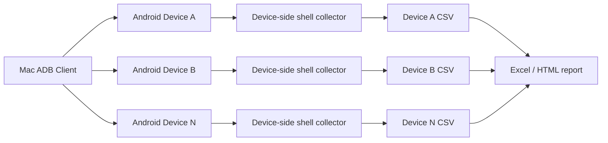

# SDP：多设备 Android 应用性能监控方案

**文档类型**：Solution Design Proposal（解决方案设计方案）  
**版本**：1.0  
**日期**：2026-08-12  
**目标平台**：macOS + Android + ADB；Android 设备端独立运行  
**目标应用**：`com.uusafe.portal`

## 1. 背景与目标

当前 Mac 已经可以通过 ADB 连接 Android 设备，并完成单台设备 10 分钟 CSV 采集。后续需要监控其他设备，且不安装 Agent、不依赖 Windows 直连，统一使用 ADB 完成设备识别、性能采集和结果导出。

本方案的目标是：

- 一台 Mac 管理多台 Android 设备；
- 每台设备按 ADB serial 独立采集，避免串设备；
- 默认监控 10 分钟、每 10 秒采样一次；
- 每台设备生成独立 CSV，同时保留日志；
- 设备不可达、未授权、App 未运行或权限不足时明确标记，不伪造数据；
- 采集结束后可继续生成 Excel/HTML 报告。

## 2. 范围与边界

### 2.1 支持范围

- USB ADB；
- Android 11 及以上已开启并配对的无线调试；
- 多台设备并行采集；
- CPU、主进程 CPU、RSS、PSS、采集状态；
- 按配置扩展网络、电量、温度、UI、稳定性、设备信息等指标。

### 2.2 明确限制

- 不能通过 ADB 命令唤醒完全没有 ADB 通道的设备；
- `adb tcpip 5555` 必须在已有 ADB 连接上执行，不能作为首次连接手段；
- 普通非 debuggable App 通常无法通过 `run-as` 读取应用私有目录和精确应用 I/O；
- Android 设备端独立运行模式不需要 Mac 或 ADB 连接，但依赖设备上的终端 App 权限；
- 受权限限制的字段必须留空并标记 `partial` 或对应限制，不得填写 0；
- `cold` 启动模式会改变目标 App 状态，多设备常规监控默认使用 `none`。

## 3. 总体架构



采集脚本在 Android 设备端执行，Mac 负责：

1. 发现和校验设备；
2. 以 `adb -s <serial>` 固定目标设备；
3. 并行启动各设备采集；
4. 为每台设备写入独立 CSV 和日志；
5. 采集结束后核验结果。

### 3.1 设备端独立运行模式

对于不能直接连接 Mac 的设备，使用：

```text
android_app_perf_monitor.sh
run_android_local_monitor.sh
```

两个文件放在 Android 终端 App 可读写的同一目录，直接在设备上执行：

```sh
chmod +x android_app_perf_monitor.sh run_android_local_monitor.sh
./run_android_local_monitor.sh 10m 10 com.uusafe.portal ./portal_10m.csv
```

该模式不调用 `adb`，不需要 Mac 在线；CSV 和日志都保存在 Android 设备本地。采集器会自动选择终端 App 可写的临时目录，不固定依赖 `/data/local/tmp`。

## 4. 设备接入流程

### 4.1 USB 设备

设备开启“开发者选项 → USB 调试”，解锁设备并确认 RSA 授权。Mac 执行：

```bash
adb kill-server
adb start-server
adb devices -l
```

只有状态为 `device` 的设备进入采集队列。

### 4.2 无线调试设备

设备端开启“无线调试”，Mac 与设备处于同一网络。首次配对：

```bash
adb pair <设备IP>:<配对端口>
adb connect <设备IP>:<调试端口>
adb devices -l
```

之后仍以 `adb -s <IP>:<端口>` 作为唯一目标标识。无线调试端口变化时，需要重新发现并更新设备清单。

### 4.3 设备状态分类

| ADB 状态 | 处理方式 | 是否采集 |
| --- | --- | --- |
| `device` | 读取设备信息并开始能力检查 | 是 |
| `unauthorized` | 在设备上确认 USB 调试授权 | 否 |
| `offline` | 重插 USB、重启 ADB 或重新连接无线调试 | 否 |
| 未出现在列表 | 检查线缆、网络、无线调试和设备是否开机 | 否 |

## 5. 单台设备能力检查

对每个设备必须带 serial 执行，不能依赖 ADB 默认选设备：

```bash
SERIAL='<SERIAL>'

adb -s "$SERIAL" shell id
adb -s "$SERIAL" shell getprop ro.product.model
adb -s "$SERIAL" shell getprop ro.build.version.release
adb -s "$SERIAL" shell pidof com.uusafe.portal
adb -s "$SERIAL" shell dumpsys meminfo com.uusafe.portal
```

能力检查输出至少包括：

- ADB 是否可执行；
- Android 版本、厂商和型号；
- 目标 App 是否安装；
- 目标 App 是否有运行进程；
- `shell` 权限是否可以读取 CPU、PSS、RSS；
- 应用级 I/O、应用私有目录等字段是否受限。

## 6. 多设备采集方案

现有采集器文件为：

```text
android_app_perf_monitor.sh
```

单台设备执行示例：

```bash
SERIAL='<SERIAL>'
STAMP=$(date +%Y%m%d_%H%M%S)
OUT="monitor_${SERIAL}_${STAMP}.csv"
LOG="monitor_${SERIAL}_${STAMP}.log"

adb -s "$SERIAL" shell sh -s 10m 10 com.uusafe.portal none \
  < android_app_perf_monitor.sh \
  > "$OUT" 2> "$LOG"
```

多台已连接设备并行执行：

```bash
mkdir -p reports

while read -r SERIAL; do
  [ -n "$SERIAL" ] || continue
  STAMP=$(date +%Y%m%d_%H%M%S)
  OUT="reports/portal_${SERIAL}_${STAMP}.csv"
  LOG="reports/portal_${SERIAL}_${STAMP}.log"

  adb -s "$SERIAL" shell sh -s 10m 10 com.uusafe.portal none \
    < android_app_perf_monitor.sh \
    > "$OUT" 2> "$LOG" &
done < <(adb devices | awk '$2 == "device" {print $1}')

wait
```

生产使用时建议再增加设备名称映射，文件名使用“业务名称 + serial 后四位 + 时间”，避免只看长 serial 难以识别设备。例如：

```text
reports/portal_测试机A_0033_20260812_193000.csv
reports/portal_测试机A_0033_20260812_193000.log
```

serial 仍必须保存在 CSV 或运行参数中，作为设备唯一标识。

## 7. 默认采集与扩展采集

### 7.1 默认采集

默认配置适合快速、多设备基线：

- 时间戳；
- 运行时长；
- 包名；
- 整机总算力口径 CPU；
- 单核标准 CPU；
- 主进程 CPU；
- RSS；
- PSS；
- 采集状态。

推荐参数：10 分钟、10 秒间隔、`launch=none`。

### 7.2 扩展采集

编辑 `采集配置.conf` 的 `COLLECT_*` 和 `DISPLAY_*` 开关，可扩展：

- 进程数、PID、线程数；
- 网络流量；
- 电量和温度；
- gfxinfo 帧和卡顿；
- 崩溃、ANR 和 Logcat 错误；
- 系统 CPU、负载、内存和存储；
- 设备信息。

采集开关控制是否读取，显示开关控制是否输出列。两者必须分别理解，关闭的字段不得当成 0。

## 8. 输出与核验

每台设备至少生成：

```text
reports/
├── portal_<device>_<timestamp>.csv
└── portal_<device>_<timestamp>.log
```

完成后检查：

```bash
CSV='reports/portal_<device>_<timestamp>.csv'

wc -l "$CSV"
head -2 "$CSV"
tail -2 "$CSV"
awk -F, 'NR > 1 {print $NF}' "$CSV" | sort | uniq -c
```

验收标准：

- 设备 CSV 的首行表头存在；
- 至少有 1 条数据；
- 最后一条 `elapsed_s` 接近设定时长；
- 设备序列号与文件名/运行参数一致；
- 采集状态可解释；
- 日志为空或只包含已知的非致命提示；
- 不同设备的 CSV 行数和内容不混淆。

## 9. 故障处理

| 现象 | 结论 | 处理 |
| --- | --- | --- |
| `unauthorized` | 设备未授权此 Mac | 解锁设备并确认授权 |
| `offline` | ADB 通道异常 | 重插、重启 ADB 或重新 `adb connect` |
| `no_process` | App 未运行或进程不可见 | 启动 App；不要将空值当作 0 |
| PSS/RSS 有值，I/O 为空 | shell 权限限制 | 保留空值并在报告标记限制 |
| 采集过程中设备掉线 | 本次采集不完整 | 保留已有 CSV，记录掉线时间并标记 partial |
| 多台设备输出混在一起 | 未使用 serial | 所有命令强制加 `adb -s <serial>` |
| 无线设备消失 | 网络或无线调试状态变化 | 检查同网段、IP、调试端口和配对状态 |

## 10. 运行安全

- 不使用 `adb shell am force-stop`，除非明确要做冷启动测试；
- 不执行 `adb uninstall`、`pm clear`、恢复出厂或修改系统设置；
- 不把 ADB 5555 端口暴露到公网；
- 无线 ADB 仅在受信任局域网使用；
- 多设备采集前先固定 serial，避免把数据写到错误设备；
- 采集结束后保留 CSV 和日志，便于追溯设备掉线或权限变化。

## 11. 实施建议

### 第一阶段：立即可用

- 继续使用现有 `android_app_perf_monitor.sh`；
- 每台设备先手工执行能力检查；
- 使用多设备并行命令生成独立 CSV；
- 先以 CPU、RSS、PSS 作为统一基线。

### 第二阶段：小工具化

增加一个 macOS 入口 `run_multi_device_monitor.sh` 或 Python GUI，自动完成：

1. 扫描 `adb devices -l`；
2. 显示设备型号和 serial；
3. 选择设备、包名、时长和采样间隔；
4. 并行启动采集；
5. 自动命名 CSV；
6. 显示每台设备进度和掉线状态；
7. 结束后生成汇总表。

### 第三阶段：报告统一

为每台设备生成 HTML/Excel，并增加跨设备对比：

- 平均 CPU、P95 CPU、最大 CPU；
- 平均 PSS、P95 PSS、最大 RSS；
- 卡顿率和帧耗时；
- 采集覆盖率和缺失字段；
- ADB 连接中断次数。

## 12. 结论

在不安装 Agent 的前提下，多设备监控可以通过“Mac + ADB + 设备端 shell 采集器”实现。关键不是把多个设备连到一个默认 ADB 会话，而是：

1. 每台设备先通过 `adb devices -l` 识别；
2. 所有命令强制使用 `adb -s <serial>`；
3. 每台设备独立进程、独立 CSV、独立日志；
4. 对不可达和权限不足的字段如实标记；
5. 采集结束后按设备核验结果。
